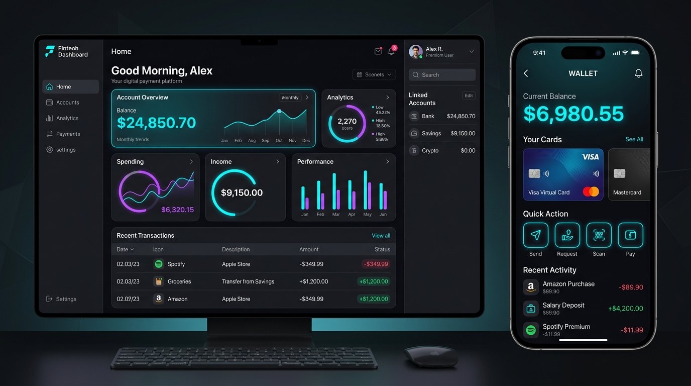
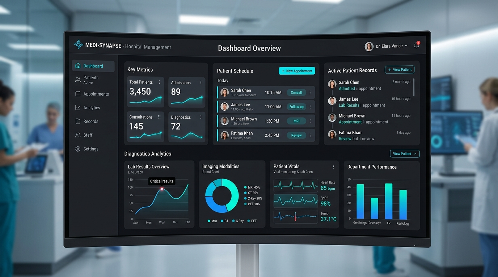
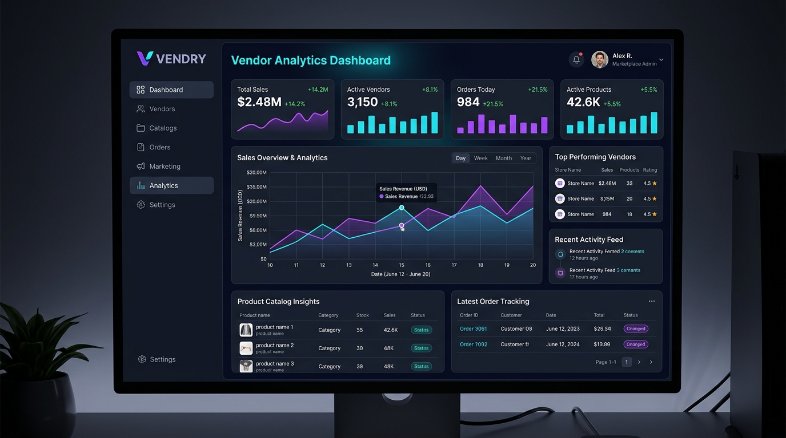

# 🚀 Futuristic Tech Portfolio - Hafizh Naufal Zain

> Modern, high-performance portfolio website for a **System Analyst** & **IT Solution Architect**. Built with responsive design, fluid animations, and cyber-tech aesthetics.


---

## 🌟 Live Demo
- **GitHub Pages**: `https://<your-username>.github.io/<repository-name>/`
- **Local (XAMPP)**: `http://localhost/portfolio/`

---

## 📸 Project Previews

| Enterprise ERP System | Digital Payment Platform |
| :---: | :---: |
|  |  |
| **Hospital Management System** | **Multi-vendor Marketplace** |
|  |  |

---

## ✨ Features

- 🌌 **Futuristic Cyberpunk Aesthetic**: Deep dark theme, dynamic cyan & neon purple accents, interactive particle canvas.
- 📱 **100% Fully Responsive & Mobile-Ready**:
  - Touch-optimized drawer navigation menu with smooth backdrop blur.
  - Quick Download CV button integrated inside mobile drawer.
  - Adaptive typography with CSS `clamp()`.
  - Touch-friendly portfolio cards with direct visibility on smartphones.
- 📐 **Edge-to-Edge Fluid Layout**: Wide container spanning near the corners of the screen (`--container-max: min(98.5%, 1920px)`).
- ⚡ **Lightweight & Fast**: Pure Vanilla HTML5, CSS3, and JavaScript — zero heavy external framework dependencies.
- 🔍 **SEO & Accessibility**: Semantic HTML5 tags, descriptive meta tags, and ARIA attributes.

---

## 🛠️ Tech Stack

- **Markup**: HTML5 Semantic Elements
- **Styling**: Vanilla CSS3 (Custom Properties, Flexbox, CSS Grid, Glassmorphism)
- **Scripting**: Vanilla JavaScript (ES6+, Intersection Observer, Canvas API)
- **Typography**: Google Fonts (*Outfit*, *Inter*, *JetBrains Mono*)

---

## 📂 Project Structure

```bash
portfolio/
├── assets/             # Supporting assets
├── pict/               # Project images & profile photo
│   ├── profile.jpg     # Profile avatar
│   ├── project-1.jpg   # ERP System preview
│   ├── project-2.jpg   # Payment Platform preview
│   ├── project-3.jpg   # Hospital Management preview
│   ├── project-4.jpg   # Marketplace preview
│   └── hero-bg.jpg     # Hero background image
├── cv.pdf              # Curriculum Vitae file
├── index.html          # Main HTML structure
├── style.css           # Design system & responsive styles
├── script.js           # Interactive features & animations
└── README.md           # Documentation & GitHub preview
```

---

## 🚀 How to Run Locally

### Using XAMPP (Apache):
1. Place this project folder in `xampp/htdocs/portfolio/`.
2. Open **XAMPP Control Panel** and start **Apache**.
3. Open your browser and navigate to:
   ```
   http://localhost/portfolio/
   ```
4. To test on mobile via local Wi-Fi:
   ```
   http://<YOUR_LOCAL_IP>/portfolio/
   ```

---

## 🌐 How to Deploy to GitHub Pages

1. **Initialize Git & Commit**:
   ```bash
   git init
   git add .
   git commit -m "feat: complete futuristic portfolio with all project photos"
   ```

2. **Connect to Remote Repository**:
   ```bash
   git branch -M main
   git remote add origin https://github.com/<your-username>/<your-repo-name>.git
   git push -u origin main
   ```

3. **Activate GitHub Pages**:
   - Go to your repository on GitHub.
   - Click **Settings** > **Pages** (under Code and automation).
   - Under **Build and deployment** > **Branch**, select `main` and `/ (root)`, then click **Save**.
   - Your site will be live at `https://<your-username>.github.io/<your-repo-name>/` in 1–2 minutes!

---

## 👤 Author

**Hafizh Naufal Zain**
- Role: System Analyst & IT Consultant
- Email: `hafizh@email.com`
- Location: Indonesia
